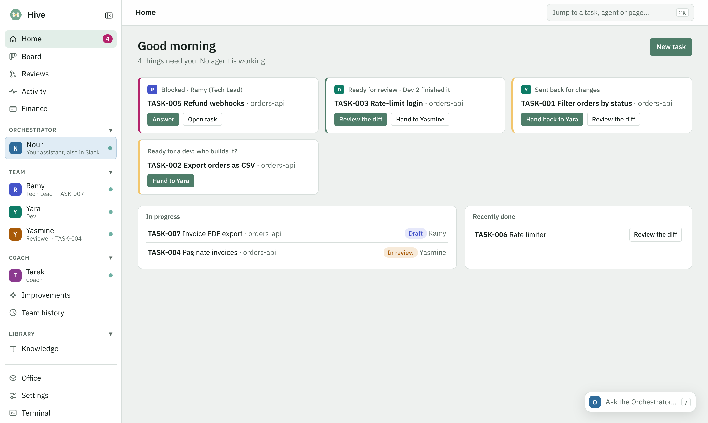
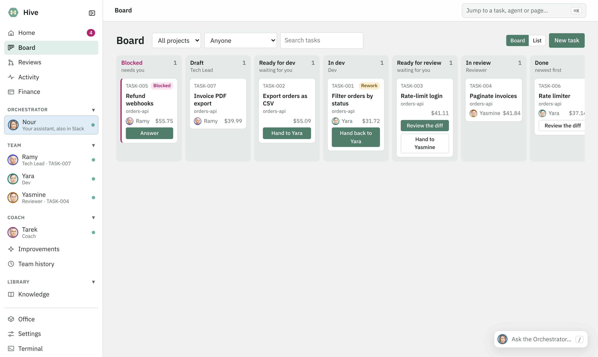
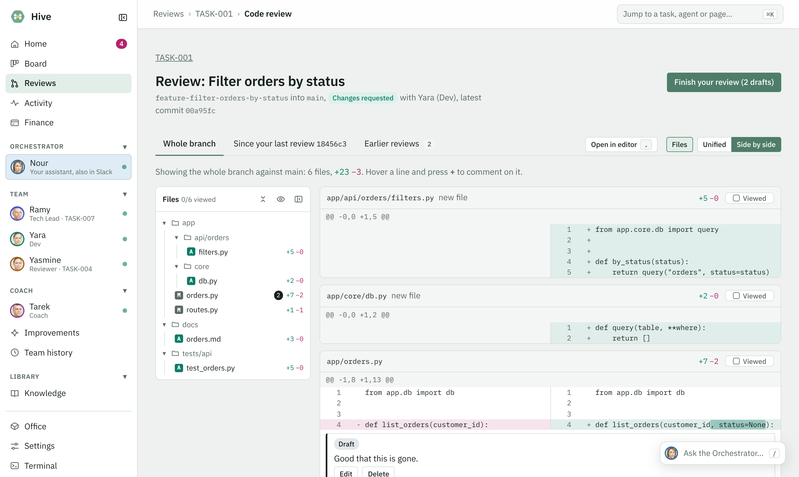

<p align="center">
  
</p>

<h1 align="center">Hive</h1>

<p align="center">
  An AI engineering team for your codebase: a Tech Lead, Developers and Reviewers that spec, build and review
  your features, a Coach that teaches them your standards, and an Orchestrator you run them through,
  from a web console or Slack.
</p>

<p align="center">
  <a href="docs/INSTALL.md">Install</a> ·
  <a href="docs/USAGE.md">Usage</a> ·
  <a href="docs/CONSOLE.md">Console</a> ·
  <a href="docs/DEVELOPMENT.md">Development</a>
</p>

<p align="center">
  
</p>

## How it works

```
You ─► Tech Lead ─► spec agreed with you ─► Dev ─► code + tests on a feature branch ─► Reviewer ─► Done
                                             ▲                                            │
                                             └─────── changes requested (reviewer or you) ┘
```

Every task is a Markdown file on a shared board. Agents claim tasks, work in their own git worktree and hand off
to each other. You approve anything they want to run, review the code when you choose, and decide who takes what
next. Nothing is pushed to your remote.

## Features

**The team**
- **Tech Lead**: studies the codebase, looks for code to reuse, and interviews you until the spec has no open questions.
- **Developers**: build exactly what the spec asks, consistent with the existing code, with unit tests.
- **Reviewers**: check that the requirements are met and that the code fits what already exists.
- **Coach**: reviews how past tasks went (your corrections, review rounds, pull-request comments) and proposes small, evidence-based changes to the team's instructions for your approval.
- **Orchestrator**: your assistant for running the team: status, links, starting agents, handing tasks on and passing messages, each after you approve.
- **Several agents per role**, working in parallel without collisions: atomic task claims and one worktree per feature.

**Workflow**
- **One board for all your projects**: Draft → Ready for dev → In dev → Ready for review → In review → Done, plus Blocked.
- **Feature branches** (`feature-<title>`) from the base branch you confirm; follow-up tasks add commits to the same branch.
- **Readiness checks** before a spec reaches a developer, and **approval prompts** before any command runs.
- **Knowledge cache**: the Tech Lead keeps notes per repository and service, refreshed from git, so each task starts from what it already knows.
- **Your preferences, enforced**: [`PREFERENCES.md`](team/PREFERENCES.md) (code style, reuse, simplicity, test structure) is binding for every agent.

**Your review**
- **Pull-request view** of any task's diff: the whole feature, this task's commits, or what changed since your last review; unified or side by side.
- **Line and general comments**: request changes and the task goes back to the developer who built it, who answers every comment.
- **Team history**: every change to the team's instructions is a commit you can diff, inspect or undo.

**Console and Slack**
- **Web console**: Home (what needs you), a kanban board, chats with every agent, code review, cost per task, activity and a browser terminal.
- **Slack**: talk to the Orchestrator or any agent, approve requests with buttons, and follow each task in its own thread.
- **Runs locally or on a server** behind a VPN, with optional password sign-in; light and dark themes; works on phones.
- **Model choice per agent**: Claude (through Claude Code), OpenAI, DeepSeek, Qwen or Kimi.

<p align="center">
  
  
</p>

## Quick start

Requirements: [Claude Code](https://code.claude.com) (logged in), Python 3, git and [uv](https://docs.astral.sh/uv/), on macOS or Linux.

```bash
git clone git@github.com:ramyeid/hive-ai-squad.git ~/hive-ai-squad
cd ~/hive-ai-squad
bash scripts/install.sh
bash scripts/start.sh      # opens http://127.0.0.1:8420
```

Open the Tech Lead and describe what you need, for example: *"In ~/code/my-api, users need to reset their password
by email."* See [Installation](docs/INSTALL.md) for servers, Slack and other AI providers.

## Documentation

| | |
|---|---|
| [Installation](docs/INSTALL.md) | Requirements, install, updates, running on a server, Slack, AI providers, uninstall |
| [Usage](docs/USAGE.md) | A task from start to finish, code review, the Coach, several agents per role, the terminal |
| [Console](docs/CONSOLE.md) | Every page of the console, approvals, costs, the browser terminal |
| [Development](docs/DEVELOPMENT.md) | Repository layout, architecture, tests, adding an AI provider |
| [`TEAM.md`](team/TEAM.md) | The process every agent follows |
| [`PREFERENCES.md`](team/PREFERENCES.md) | How you want things built |

## Repository layout

```
team/           the agents, their process (TEAM.md), your preferences, templates, and the tools they run
backend/        the server (Python, FastAPI): agents, approvals, code review, Slack
frontend/       the web console (vanilla JS, no build step)
integrations/   Slack's app manifest
scripts/        install, start, stop, migrate
assets/         logos and icons
docs/           documentation
```

Everything that is yours (the board, the Tech Lead's notes, the Coach's work, settings and conversations) lives in
`data/`, stays on your machine and is never committed.
